# Los cuatro retos – Desarrollo de Aplicaciones Móviles 2026

**Alumno:** (Ramirez Lopez Maria Yazmin)
**Matrícula:** (1225100355)
**Grupo:** (GTID241)
**Materia:** Desarrollo de Aplicaciones Móviles 2026

Aplicación desarrollada en **Flutter** con cuatro pestañas (una por reto), probada en un emulador de Android (Pixel 8, API 36). Cada reto consume una API pública distinta.

| Reto | Archivo | API usada |
|------|---------|-----------|
| 1. Recomendador de películas | `lib/reto1_peliculas.dart` | TMDB |
| 2. Memes de gatos | `lib/reto2_gatos.dart` | Cataas |
| 3. Clima minimalista (+ geolocalización) | `lib/reto3_clima.dart` | OpenWeatherMap |
| 4. Convertidor de criptomonedas | `lib/reto4_cripto.dart` | CoinGecko |

---

## Cómo ejecutar el proyecto

1. Instala las dependencias: `flutter pub get`
2. Reemplaza las API keys de ejemplo por las tuyas:
   - `lib/reto1_peliculas.dart` → `_apiKey` (TMDB)
   - `lib/reto3_clima.dart` → `_apiKey` (OpenWeatherMap)
3. Enciende un emulador y ejecuta: `flutter run`

Los retos 2 (gatos) y 4 (cripto) no necesitan API key.

## Evidencia de ejecución

Estas capturas muestran el emulador detectado por Flutter y la aplicación compilándose y ejecutándose.

**Dispositivos detectados (`flutter devices`)**

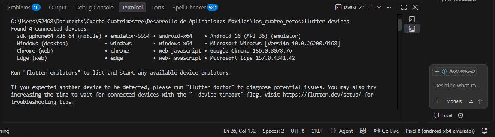

**Aplicación en ejecución (`flutter run`)**

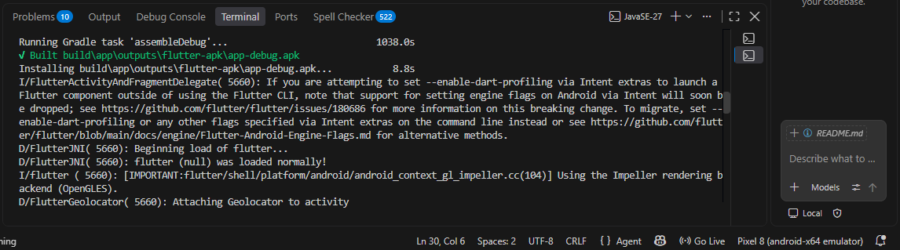
---

## Reto 1 – Recomendador de Películas del Fin de Semana

Consume la API de **TMDB** y muestra películas en tarjetas con póster, calificación y sinopsis. Permite filtrar por estado de ánimo y elegir una película al azar.

**Películas en tendencia**

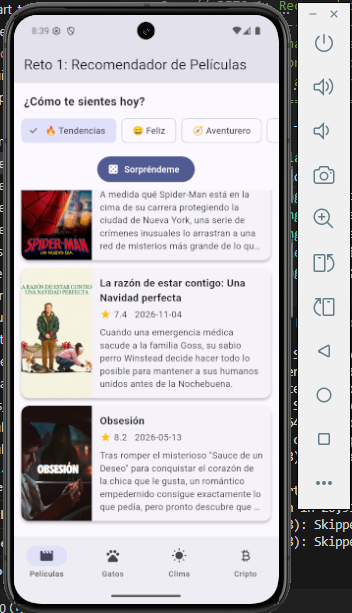

**Filtro por estado de ánimo: Feliz**

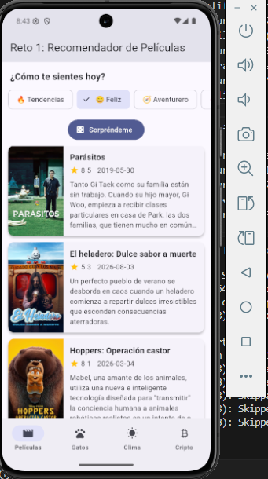

**Filtro por otro estado de ánimo**

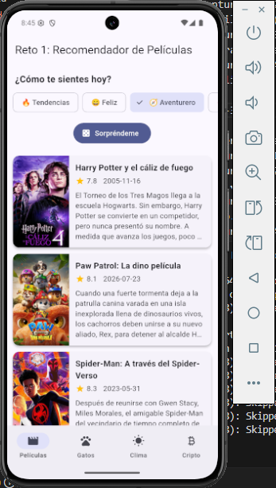

**Película al azar con "Sorpréndeme"**

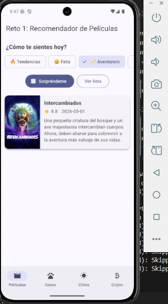

---

## Reto 2 – Generador de Memes de Gatos

Consume la API **Cataas**. El texto escrito por el usuario se agrega a la URL para que aparezca sobre la imagen del gato.

**Gato con el texto inicial**

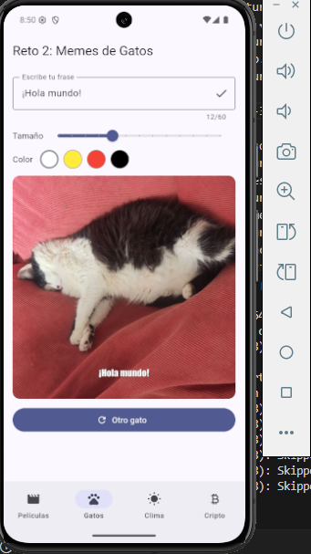

**Gato con una frase personalizada**

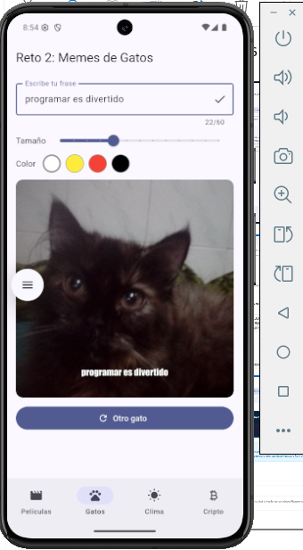

**Cambio de tamaño y color del texto**

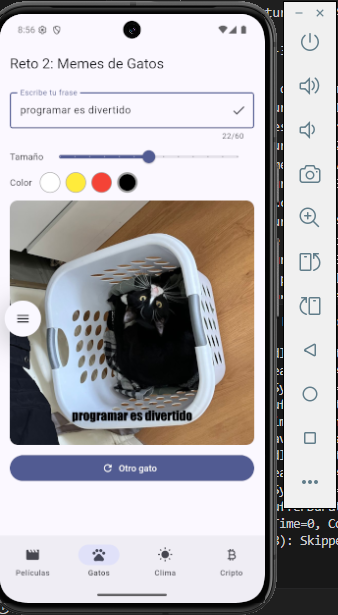

**Otro gato con la misma frase**

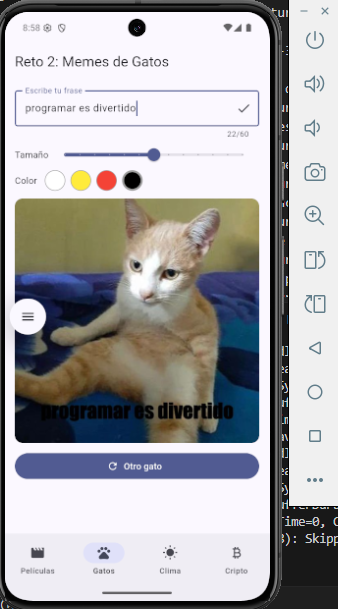

---

## Reto 3 – App del Clima Minimalista

Consume la API de **OpenWeatherMap** para mostrar el clima actual por ciudad. Incluye el "plus" de ubicación automática con el paquete `geolocator`.

**Clima de una ciudad**

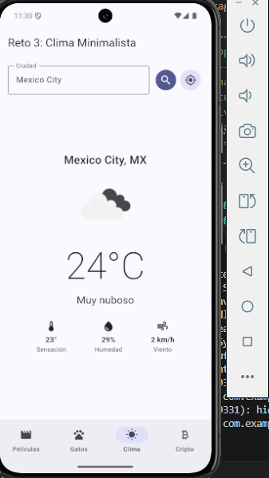

**Búsqueda de otra ciudad**

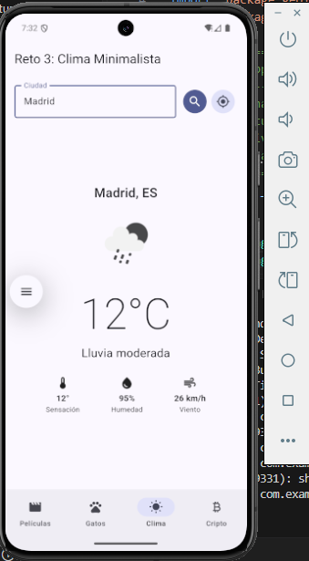

**Permiso de ubicación de Android**

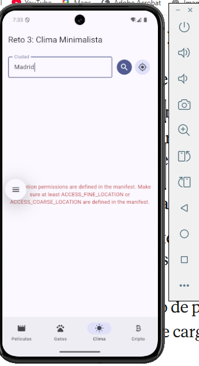

**Clima con ubicación automática**

**Manejo de errores: ciudad no encontrada**

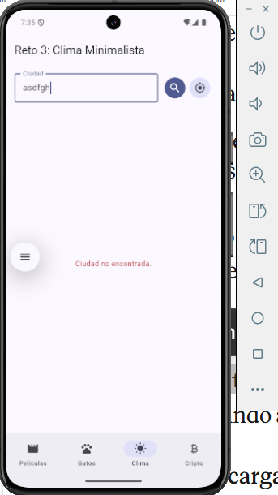

---

## Reto 4 – Convertidor de Criptomonedas en Tiempo Real

Consume la API pública de **CoinGecko** para mostrar el precio en USD de Bitcoin, Ethereum y Solana, y calcula cuántas fracciones se comprarían con el monto ingresado.

**Precios actuales y conversión de 100 USD**

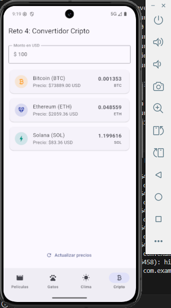

**Conversión con un monto con decimales**

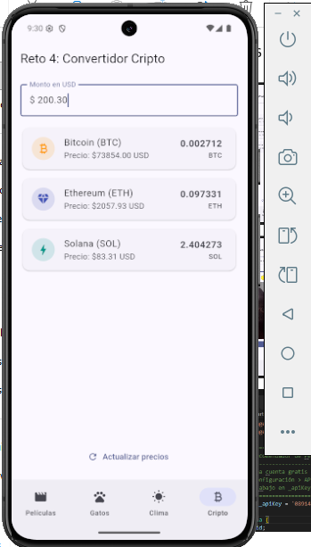

**Precios después de actualizar**

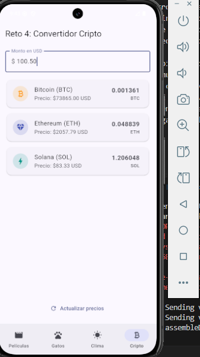

---

## Qué se practicó en cada reto

1. **Películas:** peticiones HTTP con `http`, parseo de JSON a un modelo (`Pelicula.fromJson`), `FutureBuilder` y `Card` con póster.
2. **Gatos:** URL dinámica con `Uri.encodeComponent` y los parámetros `fontSize` y `fontColor`.
3. **Clima:** búsqueda por ciudad, `CircularProgressIndicator`, manejo de errores y ubicación con `geolocator`.
4. **Cripto:** endpoint `simple/price`, `double.tryParse`, cálculo monto ÷ precio y refresco con `setState`.
